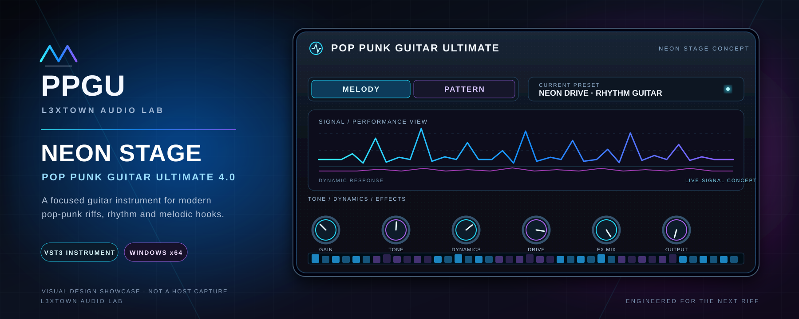

<div align="center">

# POP PUNK GUITAR ULTIMATE — REV.20 OFFICIAL

**L3XTOWN AUDIO LAB**  
**JUCE 9.0.6 · C++23 Production · C++26 Experimental · Windows 10 x64 · VST3**




**APPROVED VISUAL BASELINE · NEON STAGE DEFAULT · SKIN-1 · skin-053**

[Product baseline](docs/REV20_ACCEPTED_BASELINE_RU.md) ·
[Single development journal](Info.txt) ·
[UI implementation baseline](docs/NEON_STAGE_GUI_IMPLEMENTATION_BASELINE_RU.md) ·
[Windows validation workflow](.github/workflows/rev20-windows-vst3-skin-validation.yml)

</div>

> **Current engineering line:** [JUCE 9.0.6 / C++23 migration PR #31](https://github.com/l3xtownbeats/POP-PUNK-GUITAR-ULTIMATE-REV.20-OFFICIAL-/pull/31)  
> C++23 is the production standard. C++26 is evaluated separately using the newest compiler language mode available; it is not a release gate until the toolchain and host compatibility are proven.

---

## Product

POP PUNK GUITAR ULTIMATE is a sample-based pop-punk guitar instrument for **Windows 10 x64**, distributed as **VST3 x64**. **FL Studio 20 x64** is the required host-acceptance target.

The product has exactly two main playing modes:

- **MELODY** — one ordinary MIDI key triggers one mapped note or performance segment.
- **PATTERN** — one ordinary MIDI key triggers one mapped note/event clip, never an entire parent loop or phrase.

**AUTOCHORDS** is an auxiliary setup/workspace inside PATTERN, not a third main mode. Whole-take and phrase previews are separate browser actions.

## Approved visual identity

The canonical visual system is **NEON STAGE DEFAULT / SKIN-1 / `skin-053`**. The product has exactly **16 approved logical skins**: SKIN-1 through SKIN-16. Stable asset IDs and registry indices are immutable and are not the logical skin numbers.

The main console follows the approved reference and journal decisions:

- Header / brand and product actions.
- Left-side Factory Preset Browser.
- Center Playing Core with the dedicated guitar stage/banner.
- Nine real APVTS controls in one horizontal row, in the approved order: GAIN, TREBLE, MID, BASS, VELOCITY, DYNAMICS, SWING, HUMANIZE, ACCENT.
- Right-side AMP & TONE bay and the approved seven FX controls: COMPRESSOR, EQ, DISTORTION, CHORUS, DELAY, REVERB, CABINET IR.
- Lower live-performance display, 49-key MIDI keyboard (MIDI 36–84) and library status.
- Auxiliary workspaces for Import Guitar, FX EDIT, Pattern / Song Section Routing, AutoChords / Harmony Setup, Workspace Settings and Skin Gallery.

The visual layer must never invent functionality: AUTO SOUND HUNTER, CURATOR and ABOUT remain disabled until their real backends exist; FLANGER belongs in FX EDIT, not the seven-button main FX chain; no fake CPU/RAM meters, fake audio spectrum or false preset counts.

**Visual approval is not the same as runtime acceptance.** The main hero artwork, responsive geometry, DPI behavior, rendered snapshots and FL Studio 20 host acceptance remain subject to the exact-SHA verification gates in the journal and UI baseline.

## Audio and library contract

- One shared sample engine for MELODY and PATTERN.
- SFZ instrument mapping and sample streaming through worker-backed readers and bounded page-cache/queue infrastructure.
- File scanning, hashing, SFZ parsing and asset analysis must stay off the real-time audio callback.
- Supported sample content must have verified provenance and explicit redistribution rights.
- The target factory bank is **500 playable presets: 250 MELODY + 250 PATTERN**, all usable from the included BASIC LIBRARY.
- BASIC LIBRARY target: at least 15 GB. EXPANDED is an optional additive tier with an initial +15 GB target.
- The current 300-entry JSON catalog is a partial authored definition set, **not** a finished 500-preset playable bank. The 15 GB audio payload and full legal/playback evidence are not yet declared delivered.

## Engineering configuration

| Area | Production | Experimental |
|---|---|---|
| Framework | JUCE **9.0.6**, pinned release tag | Same pinned JUCE |
| Language | **C++23** | **C++26 latest/draft compiler mode** |
| Build | CMake 3.30+ / Windows x64 | CMake 3.30+ / compiler-dependent |
| Plugin | VST3 x64 | VST3 x64 compatibility evaluation |
| Target OS | Windows 10 x64 | Windows 10 x64 |
| Host acceptance | FL Studio 20 x64 | Same manual host test required |

### Build locally

JUCE is checked out as `JUCE/` at the pinned `9.0.6` tag by the CI workflows.

```powershell
cmake -S . -B build -A x64 -DPPGU_CXX_STANDARD=23
cmake --build build --config Release --parallel
ctest --test-dir build -C Release --output-on-failure
```

Experimental C++26 mode:

```powershell
cmake -S . -B build-cpp26 -A x64 -DPPGU_CXX_STANDARD=26
cmake --build build-cpp26 --config Release --parallel
ctest --test-dir build-cpp26 -C Release --output-on-failure
```

On MSVC, the experimental configuration uses `/std:c++latest` while CMake retains a supported baseline dialect for its own compiler checks. This is a compiler preview mode, not a claim that MSVC implements every finalized C++26 feature.

## Repository map

### Canonical product decisions and journal
- [`Info.txt`](Info.txt) — single chronological development journal and decision record.
- [Accepted product baseline](docs/REV20_ACCEPTED_BASELINE_RU.md) — locked modes, skins, audio and product constraints.
- [Decision timeline](docs/REV20_DECISION_TIMELINE_RU.md) — decision provenance and ordering.
- [Engineering workstream register](docs/REV20_ENGINEERING_WORKSTREAM_REGISTER_RU.md) — source audits and integration order.
- [Functional gap audit](docs/REV20_FUNCTIONAL_GAP_AUDIT_RU.md) — verified implementation gaps.
- [Development status](docs/DEVELOPMENT_STATUS.md) — evidence-based readiness matrix.
- [Migration manifest](docs/REV20_MIGRATION_MANIFEST.md) — accepted transfers and exclusions.

### UI, skin and visual assets
- [NEON STAGE GUI implementation baseline](docs/NEON_STAGE_GUI_IMPLEMENTATION_BASELINE_RU.md).
- [UI baseline](Docs/REV20_UI_BASELINE.md).
- [Skin approval standard](docs/REV20_SKIN_APPROVAL_STANDARD_RU.md).
- [Skin registry and runtime assets](SKIN/README.md).
- [NEON STAGE asset pack](ASSETS/PPGU_REV20_NEON_STAGE_ASSETS/README_ASSET_PACK_RU.md).
- [Asset map](ASSETS/NEON_STAGE_DEFAULT/ASSET_MAP.md).
- [Open asset issues](ASSETS/ASSET_OPEN_ISSUES.md).

### Audio, presets and library
- [Sound Hunter real-guitar baseline](docs/REV20_SOUND_HUNTER_REAL_GUITAR_BASELINE_RU.md).
- [Library tiers](docs/REV20_LIBRARY_TIERS_RU.md).
- [Approved Library Manager requirements](docs/REV20_LIBRARY_MANAGER_APPROVED_REQUIREMENTS.md).
- [Sample sourcing and licensing policy](docs/SAMPLE_LIBRARY_SOURCING_AND_LICENSE_POLICY.md).
- [Factory preset plan](docs/FACTORY_PRESET_PLAN.md).
- [Pattern clip pipeline](docs/PATTERN_CLIP_PIPELINE_RU.md).

### Build, validation and host acceptance
- [JUCE 9 / C++23 / C++26 migration record](docs/REV20_JUCE9_CPP23_MIGRATION_RU.md).
- [Windows x64 VST3 + CTest + skin + pluginval workflow](.github/workflows/rev20-windows-vst3-skin-validation.yml).
- [FL Studio 20 acceptance checklist](docs/REV20_FL20_ACCEPTANCE_CHECKLIST_RU.md).
- [CMake project](CMakeLists.txt).
- [Tests](tests/).

## Validation policy

A source change is not a passing build. A build is not a host-acceptance result. Every status must refer to the exact tested commit SHA.

Release readiness requires, at minimum:

1. JUCE 9.0.6 / C++23 Windows x64 VST3 configure and build.
2. Full CTest suite.
3. Exact 16-skin asset/registry validation and package staging.
4. pluginval strictness level 5.
5. Manual FL Studio 20 x64 acceptance on Windows 10 x64, including MIDI, preset/state persistence, UI resize/DPI and audio behavior.
6. Audio-library provenance, redistribution clearance and playable preset verification.
7. JUCE licence-model review for the intended distribution.

No release-ready status is implied by the existence of this README, the migration branch or a staged artifact.

---

**Canonical repository:** [l3xtownbeats / POP-PUNK-GUITAR-ULTIMATE-REV.20-OFFICIAL-](https://github.com/l3xtownbeats/POP-PUNK-GUITAR-ULTIMATE-REV.20-OFFICIAL-)  
**Current migration review:** [PR #31](https://github.com/l3xtownbeats/POP-PUNK-GUITAR-ULTIMATE-REV.20-OFFICIAL-/pull/31)
